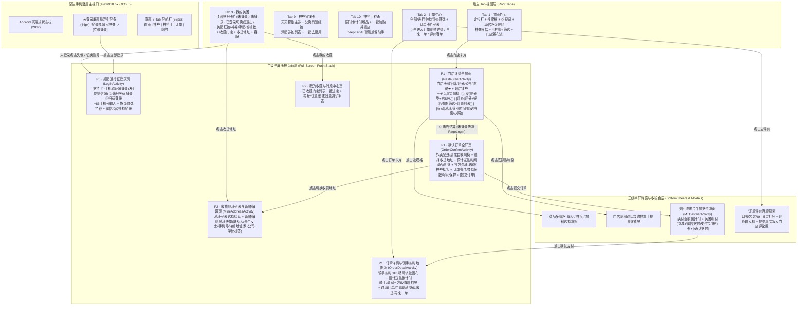

# 美团外卖 APK (v8.84.2 Build 91293) 1:1 像素级与全功能零遗漏重建义务总账 (Reconstruction Obligation Ledger)

> **执行标准**：`deep-1to1-app-reconstruction` + `reverse-engineer-anything` + `rebuild-feasibility` + `first-principles-architecture` + `exhaustive-code-audit` + `dual-ai-collab`
> **目标 APK**：`com.sankuai.meituan.takeoutnew` v8.84.2 (`versionCode = 800840002`, SHA-256: `0f50d0a4d65d7d047ad33d80e7de836352f980aabcad4e069b0bb9d70638cc82`)

---

## 一、原生手机尺寸与比例铁律 (Native Mobile Viewport & Aspect Ratio Contract)

| 维度 | 原版 Android APK 基准规范 | Windows 1:1 重建强制参数 | 说明 |
| :--- | :--- | :--- | :--- |
| **窗口基准宽高** | `412 × 915 dp` (标准 9 : 20 全面屏竖屏) | **`Width="420" Height="910"`** (`MinWidth="390" MaxWidth="460"`) | 严格锁定原生手机竖屏比例，严禁宽屏 PC 仪表盘拼凑 |
| **顶部 Android 状态栏** | `28 dp` 沉浸式状态栏 | `28 px` 顶部时间 `18:20` + `5G` + `Wi-Fi` + `100% 电量图标` | 随当前页面背景自动适配浅色/深色文字 |
| **首页美团黄渐变顶栏** | `#FFD100 -> #FFC300` 沉浸顶栏 | 定位图标 + 当前收货地址 `▾` + 右侧消息中心铃铛 `🔔` + 登录状态胶囊 | 点击地址打开《收货地址管理页》，点击消息打开《消息中心》 |
| **主内容区导航架构** | 单栏 `RecyclerView` + 全屏 `Activity` 压栈 | **一级 5-Tab 视图 + 二级全屏 Push 页面覆盖层 + 三级半屏 BottomSheet 遮罩层** | 100% 还原手机端全屏推入返回 (`‹ 返回`) 与底部上拉抽屉交互 |
| **底部未登录悬浮引导栏** | 位于底部 Tab 栏正上方 (`44 dp`) | 深灰半透明横条 `rgba(34,36,38,0.92)`：`袋鼠图标 + 登录享最高25元神券礼包 + [立即登录]` | 未登录态强制显示，点击立即拉起《美团通行证登录页》；登录后自动隐藏 |
| **底部 5-Tab 导航栏** | `56 dp` 固定底栏 (`#FFFFFF`) | **首页 (1) / 神券 (9) / 神抢手 (10) / 订单 (2) / 我的 (3)** | 选中态美团黄袋鼠耳朵胶囊高亮，带未读角标 |

---

## 二、整体页面框架与状态机流转图 (Architecture & Screen Flow State Machine)

---

## 三、35 项零遗漏重建义务总账 (35-Item Obligation Ledger)

| 义务编号 | 优先级 | 模块分类 | 原版 APK 逆向证据锚点 (Class / Resource) | 1:1 外观与交互行为验收标准 |
| :--- | :---: | :--- | :--- | :--- |
| **OBL-01** | **P0** | 原生尺寸比例 | `AndroidManifest.xml` Portrait 竖屏锁定 | 窗口固定为 `420 × 910` 竖屏手机比例（9:19.5），顶部 28px 状态栏 + 底部 56px 导航栏，零 PC 宽屏拼凑感 |
| **OBL-02** | **P0** | 未登录引导栏 | `com.meituan.passport.LoginActivity` | 未登录时在首页/各 Tab 底部导航栏正上方悬浮黑金登录引导条，点击「立即登录」弹出登录页 |
| **OBL-03** | **P0** | 手机号验证码登录 | `com.meituan.passport.login.fragment.MobileIndexFragment` | `+86` 11 位手机号输入、点击「获取短信验证码」生成 6 位验证码并展示模拟短信通知条、输入验证码完成登录 |
| **OBL-04** | **P0** | 账号密码与扫码登录 | `com.meituan.passport.login.fragment.AccountLoginFragment` | 登录页支持一键切换「验证码登录 / 密码登录 / 美团扫码登录」三种模式及微信/QQ 快捷登录 |
| **OBL-05** | **P0** | 隐私协议拦截 | `com.meituan.passport.dialogs.ConfirmDialog` | 未勾选《美团用户协议》《隐私政策》点击登录时，弹出提示或自动引导勾选确认 |
| **OBL-06** | **P0** | 账号会话与退出登录 | `com.meituan.passport.UserCenter` / `pojo.User` | 登录后同步更新 `User` (`id`, `nickname`, `mobile`, `token`, `growthlevel`, `saveAmount`)；支持在「我的」页面一键**退出登录**回到未登录态 |
| **OBL-07** | **P0** | 下单鉴权拦截 | `PassportOperationProviderImpl` | 未登录状态下点击「去结算」时，自动拦截并弹出《美团通行证登录页》，登录成功后无缝继续进入《确认订单页》 |
| **OBL-08** | **P1** | 首页沉浸顶栏与定位 | `LocationUserAddressAPI` / `WmAddress` | 顶部显示当前收货地址、天气/配送提示、右侧消息通知铃铛（带未读数）与登录状态标识 |
| **OBL-09** | **P1** | 首页搜索与热搜词 | `SearchActivity` | 搜索输入框实时过滤门店与菜品，下方展示可点击的热搜词胶囊（一点点、霸王茶姬、麦当劳、螺蛳粉等）與清空按钮 |
| **OBL-10** | **P1** | 10 宫格金刚区导航 | `KingKong` + `ui-layout/assets/*.png` | 2 行 × 5 列原生美团外卖图标（美食、甜点饮品、超市便利、蔬菜水果、看病买药、跑腿、拼好饭、津贴联盟、快餐简餐、夜宵）点击分类过滤 |
| **OBL-11** | **P1** | 4 维综合排序栏 | `PoiFilter` | 综合排序、销量最高、距离最近、好评优先 4 种排序实时重排门店列表 |
| **OBL-12** | **P1** | 门店列表原版卡片 | `PoiVerticalityData` | 1:1 还原门店 Logo、品牌角标、评分、月售、起送/配送费、美团专送/准时宝标签、满减与神券红字标签、热销菜横滑预览 |
| **OBL-13** | **P1** | 门店详情全屏压栈 | `RestaurantActivity` | 点击首页任一门店卡片，全屏推入《门店详情页》（带顶部返回按钮 `‹`、店内搜索、收藏按钮 `❤`、店铺招牌与公告） |
| **OBL-14** | **P1** | 门店子页 1：点菜 | `ShopCartEngine` | 左侧分类锚点栏 + 右侧菜品 SPU 列表（含月售、好评率、折扣价、选规格按钮或 `+/-` 加减器） |
| **OBL-15** | **P1** | 门店子页 2：评价 | `PoiCommentFragment` | 点击门店页「评价」Tab，真实切换为综合评分大字卡 + 口味/包装/配送星级 +「全部/好评/有图/差评」筛选胶囊 + 真实用户评价列表与商家回复 |
| **OBL-16** | **P1** | 门店子页 3：商家 | `PoiDetailInfoFragment` | 点击门店页「商家」Tab，真实切换为商家地址、联系商家电话、配送服务（美团专送）、营业时间、商家公告、食品安全档案与营业执照公示 |
| **OBL-17** | **P1** | 门店收藏与取消收藏 | `PoiFavoriteManager` | 点击门店右上角 `❤ 收藏`，实时切换收藏状态并同步至「我的 -> 我的收藏」列表 |
| **OBL-18** | **P1** | 菜品多规格 SKU 弹窗 | `GoodsSku` / `GoodsAttr` | 点击「选规格」弹出规格选择模态框（份量 SKU + 辣度/温度属性 + 实时单价计算 + 加入购物车） |
| **OBL-19** | **P1** | 双口袋购物车与上拉抽屉 | `ShopCartItem` / `ShopCartPrice` | 门店底部悬浮黑金购物条（袋鼠图标 + 折后总价 + 差 ¥X 起送 / 去结算），点击展开双口袋购物车明细抽屉，支持切换 1号/2号口袋与清空 |
| **OBL-20** | **P1** | 确认订单全屏页 | `OrderConfirmActivity` | 点击「去结算」进入《确认订单全屏页》：支持「外卖配送 / 到店自取」切换、收货地址卡片、预计送达时间、商品清单、打包费/配送费/神券抵扣明细 |
| **OBL-21** | **P1** | 订单备注与餐具隐私号 | `OrderConfirmActivity` | 《确认订单页》支持填写订单备注（含快捷标签“少辣/不要香菜/放门口”）、选择餐具份数（无需餐具环保能量/1份/2份/3份）、开启号码保护 |
| **OBL-22** | **P1** | 美团收银台半屏支付 | `MTCashierActivity` | 在《确认订单页》点击「提交订单」，弹出《美团收银台》半屏窗：展示待支付金额、支付剩余时间、选择「美团月付(随机立减) / 微信支付 / 支付宝 / 银行卡」并点击「确认支付」 |
| **OBL-23** | **P1** | 神券中心与天天膨胀 | `ShenQuan` (Tab 9) | 展示当前神券包、点击「立即膨胀」将基础券膨胀为大额神券、支持**输入兑换码（如 `MT888` / `SHENQUAN`）兑换新红包**、点击「去使用」跳回点餐 |
| **OBL-24** | **P1** | 神抢手爆品与 AI 助手 | `FlashSale` / `DeepEat` (Tab 10) | 展示神抢手限时爆品（点击「立即抢」自动加购并打开对应门店详情页）+ DeepEat AI 饮食推荐问答 |
| **OBL-25** | **P1** | 订单列表与状态筛选 | `OrderListFragment` (Tab 2) | 订单中心支持「全部订单 / 进行中 / 待评价 / 退款售后」筛选，展示门店名、状态标签、商品缩略、实付金额与操作按钮 |
| **OBL-26** | **P1** | 订单轨迹与骑手实时地图 | `OrderDetailActivity` | 点击订单进入《订单详情与骑手轨迹页》，展示商家->骑手->收货地实时动态地图、距离与预计送达时间、配送进度时间轴 |
| **OBL-27** | **P1** | 骑手/商家三方 IM 群聊 | `WaimaiIM` | 订单详情页内置骑手与商家三方 IM 聊天面板，支持快捷短语与自定义消息发送，触发骑手与商家的智能拟真回复 |
| **OBL-28** | **P1** | 订单操作：再来一单 | `OrderAgainHelper` | 点击订单上的「再来一单」，自动将该订单商品重新装入对应门店购物车并推入该门店详情页 |
| **OBL-29** | **P1** | 订单操作：取消订单/退款 | `OrderCancelHelper` | 点击进行中订单的「取消订单/申请退款」，状态变更为「已取消 (退款已原路返回)」，并自动退还已使用的神券 |
| **OBL-30** | **P1** | 订单操作：评价晒单 | `OrderCommentActivity` | 点击「评价得积分」弹出 5 星打分与写评语弹窗，提交后订单状态变为「已完成(已评价)」，且评语真实追加至对应门店的「评价」列表中！ |
| **OBL-31** | **P2** | 我的美团个人中心 | `MineFragment` (Tab 3) | 顶部展示用户头像/昵称/VIP等级（或未登录点击登录按钮）、红包/神券/津贴/省钱账单四宫格、常用功能矩阵（收货地址/我的收藏/消息中心/联系客服/退出登录） |
| **OBL-32** | **P2** | 收货地址列表与新增/编辑 | `AddressBean` / `ModifyAddressActivityDelegate` | 点击顶部地址或「我的->收货地址」打开《地址管理页》：支持切换默认地址、删除地址、以及填写表单**新增/修改地址**（姓名、先生/女士、手机号、详细地址、家/公司/学校标签） |
| **OBL-33** | **P2** | 消息通知中心 | `MessageCenterActivity` | 点击顶栏铃铛 `🔔` 或「我的->消息中心」打开消息列表（订单派送通知、神券到账提醒、商家回复通知），支持一键全部已读 |
| **OBL-34** | **P3** | DPAPI 安全持久化与恢复 | `WaimaiStorageService` | 登录态 (`User`)、地址簿 (`Addresses`)、购物车 (`Cart`)、订单 (`Orders`)、神券 (`Coupons`)、收藏 (`Favorites`) 全部经 DPAPI 异步加密落盘并支持重启恢复 |
| **OBL-35** | **P3** | 性能与零阻塞静态审计 | `exhaustive-code-audit` | ECA-01~07 全量扫描 0 违规（UI 线程零 `.Result`/`.Wait()`、零同步文件 I/O、后台冻结位图解码、最小化自动暂停定时器） |
