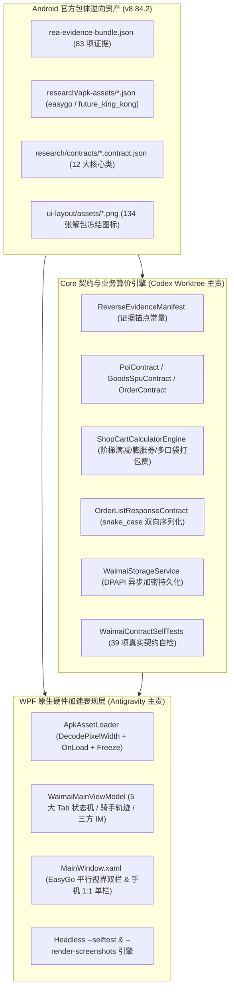

# 美团外卖 Windows 原生桌面客户端 1:1 重构架构设计说明书

- **对应官方包体**：`com.sankuai.meituan.takeoutnew` v8.84.2 (`versionCode = 800840002`, `build_number = 91293`)
- **APK SHA-256**：`0f50d0a4d65d7d047ad33d80e7de836352f980aabcad4e069b0bb9d70638cc82`
- **双 AI 研发模式**：模式 2（独立 Git Worktree 并行开发 + 双向红队交叉审查）
- **核心工程路径**：`windows-client/waimai-client/`

---

## 一、分层架构与模块职责

---

## 二、核心类与 Android 原版 DEX 字节码映射矩阵

| Windows 客户端类型 | 对应 Android DEX 逆向类 / 资源 | REA Evidence ID | 还原能力摘要 |
| :--- | :--- | :--- | :--- |
| `EasyGoMagicWindowContract` | `assets/easygo.json` (`magicwindow`) | `ev_dfa491886da7...` | 1:1 解析 `mainPages = MainActivity` 与 `relatedPage = KingKongActivity`，实现桌面双栏平行视界与手机单栏一键切换 |
| `DynamicTabContract` | `com.sankuai.waimai.business.page.homepage.MainActivity` | `ev_0063a0c6f104...` | 还原底部 5 大动态 Tab：`1` 首页外卖、`9` 神券会员、`10` 大促神抢手、`2` 订单、`3` 我的 |
| `KingKongChannelContract` | `assets/future_king_kong.json` + `WMHomePageFragment` | `ev_b83d2da5bff9...` | 还原 `future_kingkong_rcmd` (`mtmall/v1/home/market`) 与 `future_kingkong_tabs` (`mtmall/v1/home/feed`) 10 大频道宫格 |
| `PoiContract` | `com.sankuai.waimai.platform.domain.core.poi.Poi` | `ev_9cddb4225370...` | 还原门店评分、月售、起送门槛、美团专送时长、榜单芯片、阶梯满减规则与店铺神券 |
| `GoodsSpuContract` / `GoodsSkuContract` | `com.sankuai.waimai.platform.domain.core.goods.GoodsSpu` | `ev_dfec8e80b5df...` | 还原多规格 SKU 价格/库存/打包费、口味属性组（辣度/甜度/冰量/配料）及 `INotifyPropertyChanged` 加购状态 |
| `ShopCartPriceContract` / `ShopCartCalculatorEngine` | `com.sankuai.waimai.business.restaurant.base.shopcart.ShopCartPrice` | `ev_1dbf43e51054...` | 精确复刻多口袋打包费汇总、满减门槛择优、神券膨胀抵扣、配送费减免及凑单差额提示 `PreviewSubTip` |
| `OrderListResponseContract` / `OrderContract` | `com.sankuai.waimai.business.order.api.model.OrderListResponse` | `ev_85cbd0da4f81...` | 精确复刻 `digestlist`、`uncomment_count`、`refund_count` 等官方 snake_case JSON 键及骑手轨迹与三方 IM 群聊 |
| `MineProfileContract` | `com.sankuai.waimai.business.page.mine.module.MineMPFragment` | `ev_694f1ef1b578...` | 还原神券省钱卡会员中心、红包津贴、美团币及 `WmAddressContract` 地址簿管理 |

---

## 三、WPF 性能与 Exhaustive Code Audit 合规保障

1. **ECA-01（零 Sync-Over-Async）**：全库扫描 `.Result`、`.Wait()`、`.GetAwaiter().GetResult()` 命中数为 `0`。
2. **ECA-02（零 UI 线程同步磁盘/加密 I/O）**：
   - `ApkAssetLoader.PreloadAssetsAsync` 在后台线程读取 PNG 字节并构建 `Frozen` 的 `BitmapSource`；
   - `WaimaiStorageService` 使用 `Task.Run` 异步执行 `ProtectedData.Protect` / `Unprotect` (DPAPI `CurrentUser`) 读写；
   - `MainWindow.CaptureCurrentViewToPngAsync` 在后台线程执行 PNG 落盘。
3. **ECA-05（虚拟化与硬件级图像解码）**：
   - 商家列表、菜品列表、神券列表、订单列表、自检列表全部启用 `VirtualizingStackPanel.IsVirtualizing="True" VirtualizationMode="Recycling" ScrollUnit="Pixel"`；
   - 所有位图统一通过 `MemoryStream` + `BitmapCacheOption.OnLoad` + `DecodePixelWidth` + `Freeze()` 解码。
4. **生命周期感知定时器**：`MainWindow` 监听 `StateChanged`、`IsVisibleChanged`、`Closed`，最小化时自动调用 `PauseBackgroundTimers()` 停止骑手轨迹 `DispatcherTimer`，关闭时调用 `Dispose()` 解除事件订阅。
